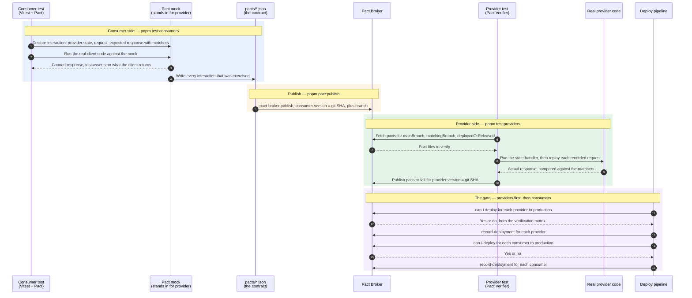

# contract-testing-lab

Consumer-driven HTTP pacts and MQTT message pacts in TypeScript, gated by
`can-i-deploy`.

The point of this repository is the last three words. Plenty of examples show
you how to write a pact; the interesting part is what happens afterwards — the
broker that outlives the build, and the gate that refuses to ship when the
evidence says no. A contract suite that nobody can block a release with is a
test suite, not an engineering control.

## The four participants

Two consumers, two providers, two integration styles.

| Participant | Package | Role |
|---|---|---|
| `web-dashboard` | `@lab/consumer-web` | Reads orders over HTTP |
| `orders-api` | `@lab/provider-api` | NestJS service serving them |
| `telemetry-processor` | `@lab/consumer-events` | Handles device telemetry messages |
| `device-gateway` | `@lab/provider-events` | Publishes them over MQTT |

The HTTP pair and the message pair are deliberately unrelated. The MQTT half
exists because message pacts are where most teams' understanding stops, and
where the limitations are least well advertised.

## How contract testing works with Pact

The consumer and the provider never run in the same test. The consumer records
what it needs into a file, the broker carries that file between the two builds,
and the provider replays it against the real code. The broker then holds enough
evidence to answer "is this version safe to deploy?".



### Step by step

The numbers match the arrows in the diagram.

**Consumer side** — `pnpm test:consumers`

1. **Declare the interaction.** The consumer test states one thing it needs
   from the provider: a provider state (`given`), a request, and the response
   it expects. From `packages/consumer-web/test/orders-client.pact.test.ts`:

   ```ts
   await pact
     .addInteraction()
     .given('an order ord-8f3a91 exists for customer cus-1042')
     .uponReceiving('a request for order ord-8f3a91')
     .withRequest('GET', '/orders/ord-8f3a91', …)
     .willRespondWith(200, (builder) => {
       builder.jsonBody({
         id: regex(ORDER_ID, 'ord-8f3a91'),
         totalPence: integer(5100),
         …
       });
     });
   ```

   The matchers (`regex`, `integer`, `like`, `eachLike`) say "this shape and
   type", not "this exact value".
2. **Run the real client.** Pact starts a local mock server and the test points
   the real `OrdersClient` at it. Nothing is stubbed inside the client, so the
   request Pact records is the request the client really sends.
3. **Assert.** The mock returns the example response and the test checks what
   the client hands back. If the client sends anything other than the declared
   request, the mock rejects it and the test fails.
4. **Write the pact file.** When the tests pass, Pact writes one JSON file per
   consumer–provider pair into `pacts/`:

   | File | Interactions | Type |
   |---|---|---|
   | `web-dashboard-orders-api.json` | 8 | `Synchronous/HTTP` |
   | `telemetry-processor-device-gateway.json` | 3 | `Asynchronous/Messages` |

   Each interaction holds the provider state, the request, the example
   response, and the matching rules. Trimmed:

   ```json
   {
     "description": "a request for the missing order ord-000000",
     "providerStates": [{ "name": "no order exists with id ord-000000" }],
     "request": { "method": "GET", "path": "/orders/ord-000000" },
     "response": {
       "status": 404,
       "body": { "content": { "title": "Order not found", "detail": "…" } },
       "matchingRules": { "body": { "$.title": { "matchers": [{ "match": "type" }] } } }
     }
   }
   ```

**Publish** — `pnpm pact:publish`

5. **Upload to the broker.** `scripts/publish-pacts.sh` runs
   `pact-broker publish pacts/ --consumer-app-version <git SHA> --branch <branch>`.
   The broker now knows "version `abc123` of `web-dashboard` on branch `main`
   expects this". If the pact content is unchanged from a previous version, the
   broker reuses the existing verification results.

**Provider side** — `pnpm test:providers`

6. **Ask the broker which pacts to verify.** The verifier sends three consumer
   version selectors (`packages/provider-api/test/support/verification-source.ts`):
   `mainBranch` (what main expects), `matchingBranch` (a consumer branch with
   the same name as this one), and `deployedOrReleased` (what is running now).
7. **Receive the pacts.** New, never-verified expectations come back marked
   pending, so they are reported without failing the provider's build.
8. **Replay against the real provider.** The test boots the real NestJS app on
   a random port. For each interaction, the verifier first calls the state
   handler named in the pact (`test/support/provider-states.ts` seeds the
   repository), then sends the recorded request.
9. **Compare.** The actual response is checked against the matching rules.
   The example values are ignored wherever a matcher covers them.
10. **Publish the result.** With `CI=true`, the verifier posts pass or fail to
    the broker against the provider's git SHA and branch, with a link to the
    build. Locally the result is not published, so a laptop run cannot change
    what the gate sees.

**The gate** — `pnpm pact:can-i-deploy`, `pnpm pact:record-deployment`

11. **Ask about the providers.** `pact-broker can-i-deploy --pacticipant
    orders-api --version <git SHA> --to-environment production`.
12. **Get the answer.** The broker looks up every consumer version recorded in
    `production` and checks there is a passing verification between it and this
    provider version. Exit code 0 means deploy; non-zero blocks the pipeline.
13. **Record the provider deployment.** After the deploy,
    `pact-broker record-deployment` tells the broker this version is now in
    `production`. Without it, the next check reasons about stale data.
14. **Ask about the consumers**, now against the providers just recorded.
15. **Get the answer.**
16. **Record the consumer deployment.**

### Where the message pact differs

The MQTT pair follows the same sixteen steps with two substitutions, because
there is no HTTP call to intercept:

| Step | HTTP (`web-dashboard` → `orders-api`) | Message (`telemetry-processor` ← `device-gateway`) |
|---|---|---|
| 2–3 | Real client calls a mock server | Pact builds the expected message and passes it to the real `handleTelemetry` |
| 8–9 | Verifier sends requests to the running app | Verifier calls `buildTelemetryEvent`, the function the real publisher uses, and compares its output and transport metadata (topic, QoS, retain) |

Neither side connects to an MQTT broker during the contract tests.

## Quick start

Requires Node 22+ (`.nvmrc`), pnpm, and Docker.

```bash
pnpm install
pnpm broker:up      # Postgres + Pact Broker at localhost:9292 (pact / pact)
pnpm loop           # the whole sequence, end to end
```

Run `pnpm loop` a second time. The first pass finds an empty environment and
takes the documented first-deployment path; only once `record-deployment` has
run does the gate have anything to reason about. The second pass is the gate
actually engaging.

```bash
pnpm broker:down    # stop; add -v via broker:reset to drop the data
```

## What the loop does

`scripts/full-loop.sh`, which is also what CI runs:

1. **Consumer tests** generate the contracts. Each consumer states what it
   uses, in a test that fails if the client code stops matching.
2. **Publish** to the broker, versioned by git SHA and tagged with the branch.
3. **Provider verification** replays every contract the broker holds and
   publishes the results back. Without this step the gate has nothing to read.
4. **Gate the providers.** `can-i-deploy` asks the only question that matters:
   given everything already running in `production`, is *this* version safe to
   put next to it?
5. **Deploy and record the providers** (the deploy is mocked). Recording is
   what lets step 6 reason about what actually shipped; skipping it is the most
   common way a working setup rots.
6. **Gate the consumers**, now against the providers this run just shipped.
7. **Deploy and record the consumers.**

Steps 4–7 are two phases rather than one, and the ordering is load-bearing —
see [Deploy providers before consumers](#deploy-providers-before-consumers).

Versions are git SHAs, never `package.json` versions: a broker version has to
identify exactly one build artefact, and a release version is identical across
dozens of commits.

## The two styles, and what each proves

**HTTP pacts** (`web-dashboard` → `orders-api`, 8 interactions) run the real
API client against a mock provider, then replay the recorded interactions
against the real NestJS app with seeded provider states.

**Message pacts** (`telemetry-processor` ← `device-gateway`, 3 interactions)
have no HTTP call to intercept. Pact constructs the message the consumer says
it expects, hands it to the handler, and records the shape; the provider then
proves it can *produce* that shape. Neither side connects to MQTT.

That last sentence is the honest limitation: **message pacts verify payload
compatibility, not delivery.** Subscription, topic filters, QoS, ordering,
retained messages and redelivery are all outside the contract. `pnpm demo:mqtt`
sends a real message across a real broker specifically to make that boundary
visible.

The mitigation used here is a naming convention: every numeric field carries
its unit (`batteryPct`, `uptimeSeconds`, `rssiDbm`). A publisher switching
`uptimeSeconds` from seconds to milliseconds changes nothing Pact can see —
still a number, still the same key — so putting the unit in the key turns an
invisible semantic change into a visible rename, which is exactly what a
message pact does catch.

## The lesson the commit history tells

Three consecutive commits stage the failure mode that kills contract testing
programmes in real teams:

1. **Pin the getOrder contract to exact values** — looks thorough.
2. **Show customers' full names in the ops tooling** — deliberately red. No
   API changed; a string in a seed fixture is a different string.
3. **Fix the contract with matchers, not the provider** — green again, and
   the provider was never touched.

The provider was never wrong. The contract had confused "an example of the
response" with "a specification of the interface". This is how the practice
dies: not through tooling failure, but through a fortnight of red builds
caused by fixture edits, until people learn that red means "someone touched
seed data" and stop reading the output.

The example values in the contract are still deliberately stale — `totalPence`
says 5100 where the provider seeds 1278. Verification passes anyway, which is
the proof that the matchers are carrying the contract rather than the two
sides having quietly agreed on a set of magic constants.

Two demos keep those claims honest on every commit rather than letting the
documentation drift:

```bash
pnpm demo:brittle   # over-specified vs resilient contract, same provider
pnpm demo:mqtt      # a real message across a real MQTT broker
```

## CI

| Workflow | Trigger | What it proves |
|---|---|---|
| `contract-tests.yml` | push, PR | The full loop against a throwaway broker, run **twice** so the second pass has recorded deployments. Needs no secrets, so it works on a fork. |
| `consumer.yml` | push, PR | Consumer tests always; publishes when a broker is configured. |
| `provider.yml` | push, PR | Verification against contracts pulled from the broker, results published back. |
| `can-i-deploy.yml` | after `provider` succeeds on `main` | The gate, in two phases: providers deployed and recorded first, then consumers. |

The ephemeral broker in `contract-tests.yml` cannot replace the other three: it
only ever knows about one commit, so its `can-i-deploy` cannot tell you whether
you have broken the consumer version that has been in production for a month.
That question needs a broker that outlives the build.

## Connecting a real broker

Set one repository variable and one secret. Everything broker-dependent is
gated on the variable, so with it unset the workflows explain themselves in the
job summary instead of failing.

```bash
gh variable set PACT_BROKER_BASE_URL --body 'https://your-org.pactflow.io'
gh secret   set PACT_BROKER_TOKEN     # PactFlow: a read/write token
```

The scripts pick their auth scheme from whichever variable is populated —
bearer token if `PACT_BROKER_TOKEN` is set, basic auth otherwise — so the
self-hosted broker in `docker-compose.yml` and a hosted PactFlow both work
without changing anything else. Set `PACT_BROKER_USERNAME` / `PACT_BROKER_PASSWORD`
instead for a self-hosted broker.

If you self-host, do not carry the local config to a public host: change the
credentials, drop `PACT_BROKER_ALLOW_PUBLIC_READ`, and terminate TLS in front
of it. Keep `PACT_BROKER_DATABASE_CLEAN_ENABLED` — without it the
`pact_versions` table grows without bound and `can-i-deploy` eventually slows
to the point where people route around the gate.

## Deploy providers before consumers

Worth knowing before the gate blocks you and you assume it is broken.

Adding an interaction changes the pact's *content*, which makes it a new pact
version that the currently-deployed provider has never been proven to satisfy:

```
can-i-deploy  web-dashboard@… → production
  There is no verified pact between version … of web-dashboard
  and the version of orders-api currently in production (…)
❌ Computer says no
```

That is the gate being right, not being broken. The provider passes its own
check, because it is verified against the consumer version already in
production. Deploy and record the providers first, and the consumers then pass.

So both `can-i-deploy.yml` and `full-loop.sh` run in two phases: gate, deploy
and record the providers, then gate, deploy and record the consumers. Rolling
the provider out first is not a workaround for the gate — it is what a
backward-compatible change actually requires, and the gate is the thing that
stops you doing it in the wrong order by accident.

Gating all four together and deploying them in one step is the obvious design,
and it works right up until the first commit that changes a contract.

When a phase does block, `can-i-deploy.yml` takes a `participant` input on
`workflow_dispatch` so you can ship one side on its own.

## Layout

```
packages/consumer-web/      OrdersClient + its pact test
packages/provider-api/      NestJS orders-api + verification, states, fixtures
packages/consumer-events/   telemetry handler + message pact test
packages/provider-events/   telemetry event builder + verification
scripts/                    the pact CLI wrappers CI and humans both run
pacts/                      generated, gitignored — the broker is the truth
infra/mosquitto/            config for the MQTT demo
```

Consumers and providers deliberately do **not** share a types package. If they
did, TypeScript would catch a field rename at compile time and the pact would
have nothing left to prove — which sounds like a win until you remember these
are two separately deployed services on two release cadences, and the shared
package is only ever in step on the developer's laptop. The duplication is the
test subject.

## Not yet written

Source comments reference `docs/adr/003-versioning-and-tagging-strategy.md`,
`docs/adr/005-ephemeral-broker-in-ci.md`, ADR-001/004/006 and `docs/03`–`06`.
Those files do not exist yet. The reasoning they were meant to carry is
summarised above; the ADRs themselves are outstanding.
