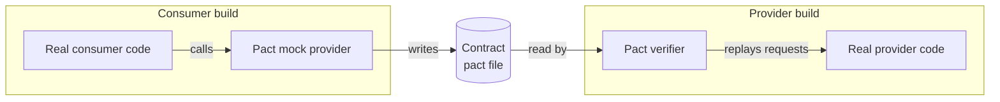
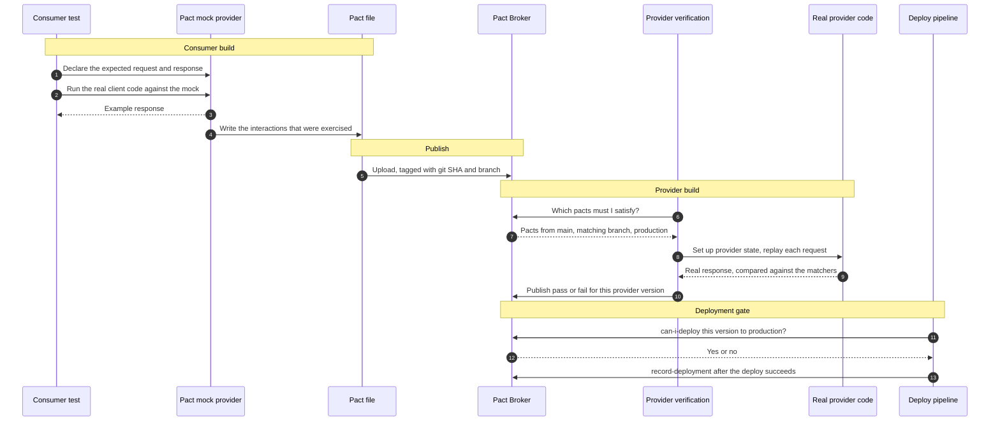
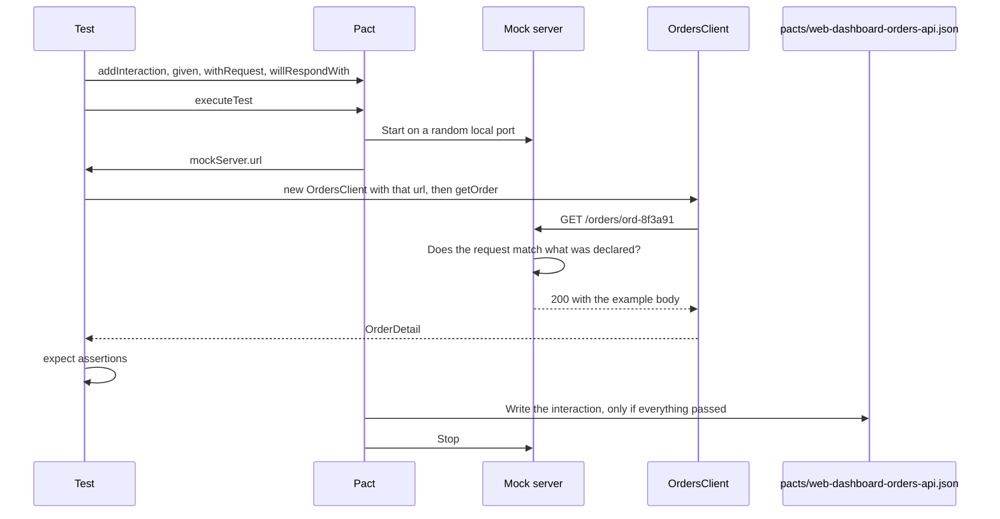
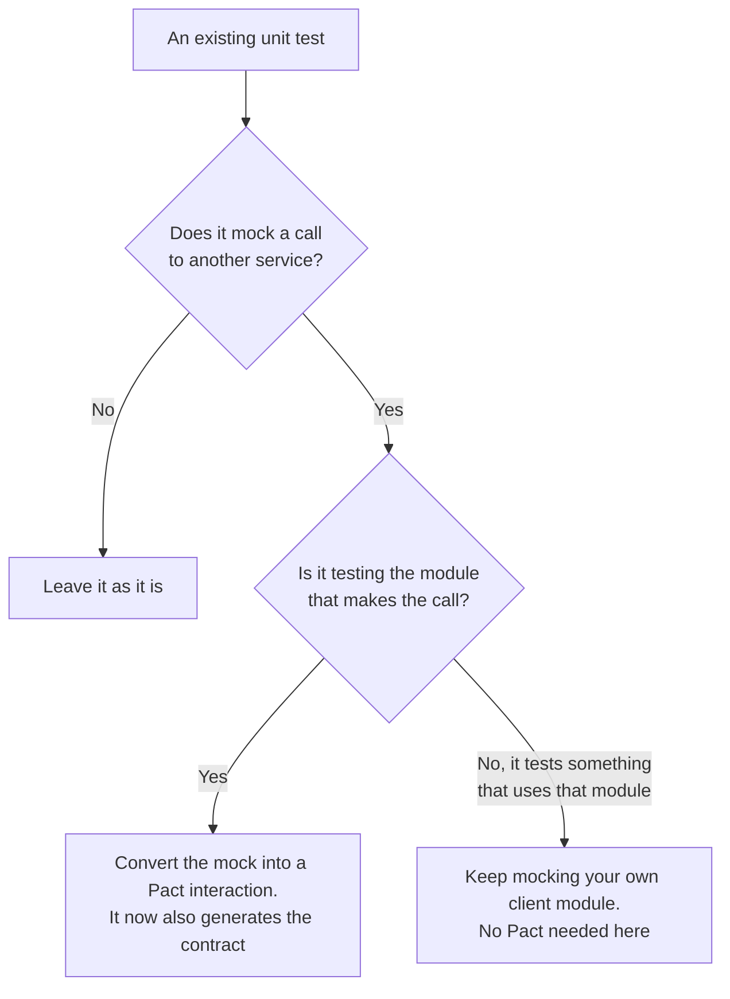
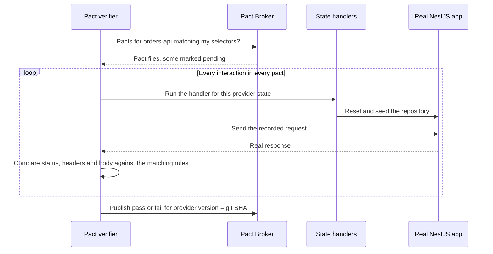
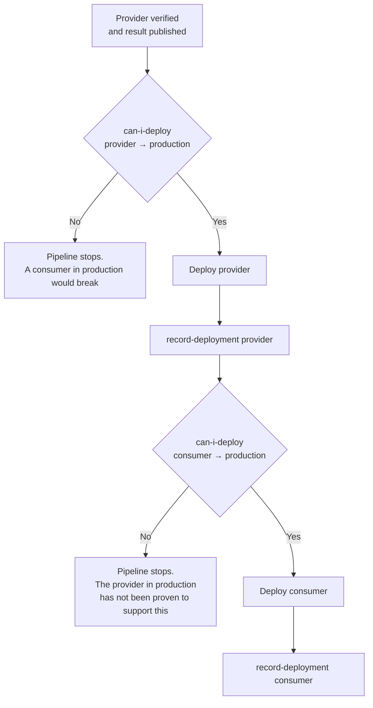
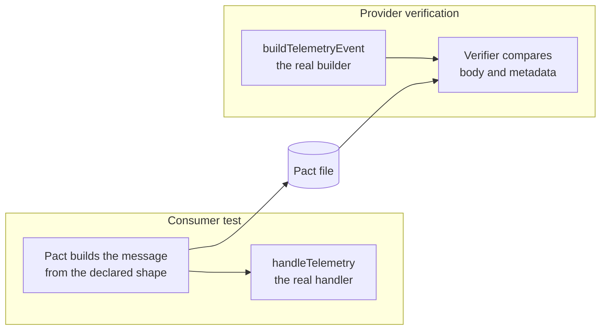
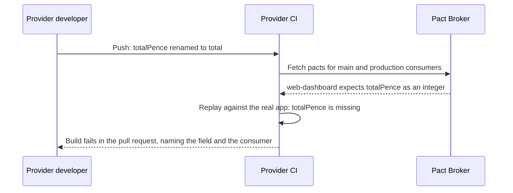
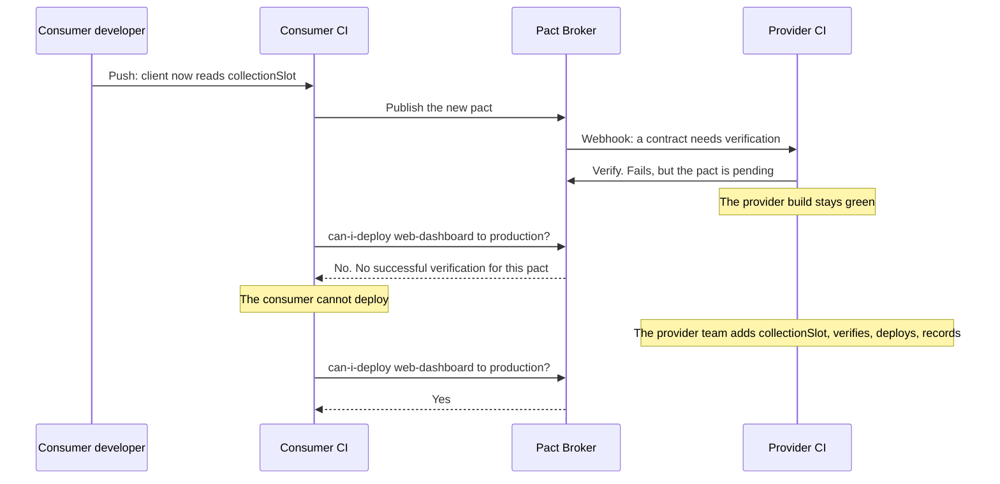
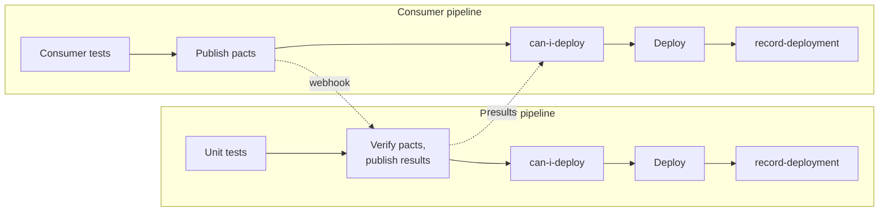

# Contract testing with Pact: a practical guide

This guide explains what contract testing is, why you would use it, and how to
implement it on both the consumer and the provider side. Every code sample and
command comes from this repository, so you can run each step yourself and copy
the parts you need into your own project.

**Contents**

1. [What contract testing is](#1-what-contract-testing-is)
2. [Why contract testing](#2-why-contract-testing)
3. [What it can be used for: HTTP, MQTT and other interfaces](#3-what-it-can-be-used-for)
4. [The vocabulary](#4-the-vocabulary)
5. [The whole flow in one picture](#5-the-whole-flow-in-one-picture)
6. [What you need: packages and setup](#6-what-you-need)
7. [Consumer side: writing the test that generates the contract](#7-consumer-side)
8. [Unit tests and contract tests: are they the same?](#8-unit-tests-and-contract-tests)
9. [Publishing the contract to the broker](#9-publishing-the-contract)
10. [Provider side: verifying the contract](#10-provider-side)
11. [The deployment gate: can-i-deploy](#11-the-deployment-gate)
12. [Message contracts: MQTT and other queues](#12-message-contracts)
13. [What happens when someone makes a breaking change](#13-what-happens-on-a-breaking-change)
14. [Setting up the broker: PactFlow or self-hosted](#14-setting-up-the-broker)
15. [Wiring it into CI](#15-wiring-it-into-ci)
16. [Command reference](#16-command-reference)
17. [Reusing this repo in your own project](#17-reusing-this-repo)
18. [Common mistakes](#18-common-mistakes)
19. [What contract testing does not do](#19-what-contract-testing-does-not-do)

---

## 1. What contract testing is

Two services talk to each other. One asks for something (the **consumer**), the
other supplies it (the **provider**). Each side makes assumptions about the
other: which URL exists, which fields come back, what type each field is.

A **contract** is those assumptions written down in a file. **Contract
testing** checks both sides against that file, separately:

- The consumer is tested against a fake provider that behaves as the contract
  says.
- The provider is tested by replaying the contract against the real provider
  code.

If both pass against the same contract, the two services can talk to each
other. They never have to be running at the same time to prove it.



This repository uses [Pact](https://docs.pact.io), the most widely used
contract testing tool, in its **consumer-driven** form: the consumer writes the
contract, because the consumer is the one who knows which parts of the provider
it really uses.

## 2. Why contract testing

The usual way to check that two services work together is an end-to-end test:
deploy both, plus their databases and dependencies, and click through. That
works, but it has costs:

| | End-to-end tests | Contract tests |
|---|---|---|
| Needs both services running | Yes | No |
| Runs on a laptop | Rarely | Yes, in seconds |
| When a failure shows up | After deploy to a shared environment | In the pull request |
| Who sees the failure | Whoever runs the suite | The team that made the breaking change |
| Flakiness | High: network, data, timing | Low: each side runs in one process |
| Tells you if a deploy is safe | Only for the versions in that environment | For any version against what is in production |

Contract tests do not replace everything. They answer one narrow question:
**can these two services still understand each other?** Whether the answer the
provider gives is the *right* answer is still a job for unit and functional
tests (see [section 8](#8-unit-tests-and-contract-tests)).

The second benefit is the deployment gate. Because every contract and every
verification result is stored centrally, you can ask before each deploy: "is
this version compatible with what is running in production right now?" That
question is covered in [section 11](#11-the-deployment-gate).

## 3. What it can be used for

Contract testing is not limited to REST APIs. Pact supports any interface where
one side sends structured data and the other side reads it.

| Interface | Supported | How | In this repo |
|---|---|---|---|
| HTTP / REST (JSON, XML, plain text, form data) | Yes, built in | Mock server on the consumer side, request replay on the provider side | `web-dashboard` → `orders-api` |
| MQTT | Yes, as a message pact | Tests the message handler and the message builder, not the broker | `telemetry-processor` ← `device-gateway` |
| Kafka, RabbitMQ, AWS SQS / SNS, Kinesis, Azure Service Bus, Google Pub/Sub | Yes, as a message pact | Same as MQTT. Pact does not care which transport carries the message | Same pattern as the MQTT pair |
| GraphQL | Yes | GraphQL travels over HTTP, so it is an HTTP pact with a query in the body | Not shown |
| gRPC / Protobuf | Yes, with a plugin | The Pact Protobuf plugin | Not shown |
| WebSockets, server-sent events | Partly | Model each message as a message pact. The connection itself is not tested | Not shown |
| Other formats (Avro, CSV, custom) | With a plugin | The Pact plugin framework | Not shown |

Two rules of thumb:

- **Request and response** (you ask, you get an answer): use an HTTP pact.
- **Fire and forget** (someone publishes, someone else reads later): use a
  message pact.

Where contract testing fits badly:

- **Public APIs with unknown consumers.** Consumer-driven contracts need the
  consumers to write tests. For a public API, an OpenAPI specification is a
  better fit.
- **Third-party APIs you do not control.** The provider will never run your
  verification.
- **Checking business logic.** See [section 19](#19-what-contract-testing-does-not-do).

## 4. The vocabulary

| Term | Meaning |
|---|---|
| **Consumer** | The side that uses the interface: makes the HTTP call or reads the message |
| **Provider** | The side that supplies it: serves the API or publishes the message |
| **Interaction** | One request and its expected response, or one expected message |
| **Pact** (pact file) | A JSON file holding all interactions between one consumer and one provider. This is the contract |
| **Provider state** | A precondition the consumer names, such as "an order ord-8f3a91 exists". The provider sets it up before each interaction is replayed |
| **Matcher** | A rule that says "any integer" or "a string matching this pattern" instead of an exact value |
| **Pact Broker** | A server that stores pacts and verification results. PactFlow is the hosted version |
| **Verification** | The provider-side run that replays a pact against the real provider |
| **can-i-deploy** | A broker query: is this version compatible with everything in a given environment? |
| **Pacticipant** | Pact's spelling for a participant: any consumer or provider known to the broker |

This repository has four participants in two unrelated pairs:

| Participant | Package | Role |
|---|---|---|
| `web-dashboard` | `packages/consumer-web` | HTTP consumer |
| `orders-api` | `packages/provider-api` | HTTP provider (NestJS) |
| `telemetry-processor` | `packages/consumer-events` | Message consumer (MQTT) |
| `device-gateway` | `packages/provider-events` | Message provider (MQTT) |

## 5. The whole flow in one picture



In words:

1. The **consumer test** runs the real client code against a mock and writes a
   pact file.
2. The pact file is **published** to the broker.
3. The **provider verification** downloads the pacts, replays them against the
   real provider, and publishes the result.
4. Before deploying, each side asks the broker **can-i-deploy**.
5. After deploying, each side tells the broker with **record-deployment**.

The rest of this guide walks through each step.

## 6. What you need

### Packages

| Package | Where | What for |
|---|---|---|
| `@pact-foundation/pact` | Dev dependency of every consumer and provider | Writing consumer tests and running provider verification |
| `@pact-foundation/pact-cli` | Dev dependency at the repo root | The `pact-broker` command: publish, can-i-deploy, record-deployment |
| A test runner | Every package | This repo uses Vitest. Jest and Mocha work the same way |

To add them to your own project:

```bash
npm install --save-dev @pact-foundation/pact        # each consumer and provider
npm install --save-dev @pact-foundation/pact-cli    # wherever you publish from
```

This repo pins `@pact-foundation/pact` 17.1.2 and `@pact-foundation/pact-cli`
18.1.1. Pact ships a native binary for your platform as part of the install, so
there is nothing else to download.

### Tools

- **Node 22 or later** (see `.nvmrc`).
- **pnpm**, because this repo is a pnpm workspace. If `pnpm` is not installed,
  run `corepack enable` once, or prefix commands with `corepack`.
- **Docker**, only if you want to run a broker locally.

### Test runner settings

Test files that write to the same pact file must not run in separate processes
at the same time: the writes collide and the run fails with `The pact core was
unable to write the pact file`. `vitest.shared.ts` takes the cautious route and
runs every file one at a time:

```ts
export const pactRunnerDefaults: TestConfig = {
  environment: 'node',
  env: { PACT_DO_NOT_TRACK: 'true' },
  pool: 'forks',           // one real process per test file
  maxWorkers: 1,           // no parallel files
  fileParallelism: false,
  testTimeout: 60_000,
  hookTimeout: 60_000,
};
```

If you use Jest, the equivalent is `--runInBand` for the pact tests.

You can still parallelise. Different consumer and provider pairs write different
pact files, so separate packages can run side by side (pnpm already does this
here). The limit only applies to several test files for the same pair.
Provider verification only reads pacts, so it parallelises too.

To try it, opt in with an environment variable:

```bash
PACT_PARALLEL=1 pnpm test              # everything
PACT_PARALLEL=1 pnpm test:providers    # provider side only
```

To see the failure for yourself, copy the consumer test so two files write the
same pact file, then run in parallel a few times:

```bash
cd packages/consumer-web
cp test/orders-client.pact.test.ts test/copy.pact.test.ts
PACT_PARALLEL=1 pnpm exec vitest run     # repeat; some runs fail to write the pact file
rm test/copy.pact.test.ts
```

### Try it now

No broker and no Docker needed for this first run:

```bash
pnpm install
pnpm test
```

This runs the consumer tests, which write two files into `pacts/`, and then the
provider tests, which verify those files. You will see a few
`Verification unsuccessful` log lines. They come from demo tests that break a
contract on purpose to show what a failure looks like; the run still ends with
every test passing.

## 7. Consumer side

The consumer's job is to write a test that states what it needs from the
provider. Running that test generates the contract.

### Step 1: keep all provider calls in one module

Every HTTP call the dashboard makes to `orders-api` goes through one class,
`packages/consumer-web/src/orders-client.ts`:

```ts
export class OrdersClient {
  constructor({ baseUrl, fetchImpl }: OrdersClientOptions) { … }

  async getOrder(orderId: string): Promise<OrderDetail> {
    const response = await this.#fetch(
      `${this.#baseUrl}/orders/${encodeURIComponent(orderId)}`,
      { method: 'GET', headers: { Accept: 'application/json' } },
    );

    if (response.status === 404) {
      const problem = (await response.json()) as ProblemDetail;
      throw new OrderNotFoundError(orderId, problem.detail);
    }

    return this.#expectJson<OrderDetail>(response);
  }
  …
}
```

This matters for two reasons. The base URL is passed in, so a test can point
the client at a mock. And the contract is easy to keep complete: one
interaction per behaviour of this class.

### Step 2: configure Pact

From `packages/consumer-web/test/orders-client.pact.test.ts`:

```ts
import { MatchersV3, PactV4, SpecificationVersion } from '@pact-foundation/pact';

const pact = new PactV4({
  consumer: 'web-dashboard',
  provider: 'orders-api',
  dir: PACT_DIR,                 // repo-root /pacts
  spec: SpecificationVersion.SPECIFICATION_VERSION_V4,
  logLevel: 'warn',
});
```

The two names are how the broker identifies each side. They must be spelled
identically in the consumer test and in the provider verification.

### Step 3: write an interaction

Each test declares one interaction and then runs the real client against it:

```ts
it('returns the order detail the dashboard renders', async () => {
  await pact
    .addInteraction()
    .given('an order ord-8f3a91 exists for customer cus-1042')   // provider state
    .uponReceiving('a request for order ord-8f3a91')             // description
    .withRequest('GET', '/orders/ord-8f3a91', (builder) => {
      builder.headers({ Accept: 'application/json' });
    })
    .willRespondWith(200, (builder) => {
      builder.headers({ 'Content-Type': JSON_CONTENT_TYPE });
      builder.jsonBody({
        id: regex(ORDER_ID, 'ord-8f3a91'),
        status: regex(KNOWN_STATUS, 'PICKING'),
        placedAt: iso8601DateTimeWithMillis('2026-08-19T09:14:02.000Z'),
        totalPence: integer(5100),
        itemCount: integer(3),
        storeId: like('store-0042'),
        customer: {
          id: like('cus-1042'),
          displayName: like('P. Nandakumar'),
        },
        lines: eachLike(
          {
            sku: like('SKU-77120'),
            description: like('Oat milk, 1L'),
            quantity: integer(2),
            unitPricePence: integer(180),
          },
          1,
        ),
      });
    })
    .executeTest(async (mockServer) => {
      const client = new OrdersClient({ baseUrl: mockServer.url });
      const order = await client.getOrder('ord-8f3a91');

      expect(order.id).toBe('ord-8f3a91');
      expect(order.status).toBe('PICKING');
      expect(order.totalPence).toBe(5100);
    });
});
```

The four parts:

| Call | Meaning |
|---|---|
| `given(...)` | The provider state. A plain sentence the provider must be able to set up |
| `uponReceiving(...)` | A unique name for this interaction |
| `withRequest(...)` | The exact request the consumer will send |
| `willRespondWith(...)` | The response the consumer needs, described with matchers |

### What happens when this test runs



Two checks happen here:

1. **The mock checks the request.** If the client sends a different path,
   method, header or body than the one declared, the mock rejects it and the
   test fails.
2. **Your assertions check the client.** The client must correctly turn the
   example response into what the rest of the application expects.

Only when both pass does Pact write the interaction to the pact file. The
contract can therefore never claim something the consumer code does not do.

### Matchers: describe the shape, not the value

This is the part most people get wrong first. If the contract said
`totalPence: 5100` as an exact value, the provider would have to return exactly
5100 forever. The consumer does not need that. It needs an integer.

| Matcher | Means | Use when |
|---|---|---|
| `like('store-0042')` | Any value of the same type | You only care that the field exists and is a string, number or boolean |
| `integer(5100)` | Any whole number | A decimal would break you |
| `string('cus-1042')` | Any string | Same as `like` for strings, more explicit |
| `regex(/^ord-[0-9a-f]{6}$/, 'ord-8f3a91')` | A string matching the pattern | The format matters, for example you build a URL from it |
| `iso8601DateTimeWithMillis(...)` | A timestamp in that format | You parse the date |
| `uuid(...)` | A UUID | You rely on the ID format |
| `eachLike({...}, 1)` | An array with at least one item of this shape | You loop over a list |
| `equal('READY')` | Exactly this value | The exact value *is* the requirement |

The second argument to each matcher is only an example. The mock returns it
during the consumer test, and the provider ignores it during verification.

Use an exact value only when the exact value is what you depend on. This repo
has one such case: when the dashboard filters by `status=READY`, every order
that comes back must be `READY`, so that field uses `equal('READY')`.

### Cover the unhappy paths too

The contract in this repo has eight interactions, and half of them are not the
happy path:

| Interaction | Why it is in the contract |
|---|---|
| Get an order that exists | The main case |
| Get an order that does not exist (404) | The client reads `detail` from the 404 body to show an empty state |
| List a customer's orders | The main case |
| List with a status filter | The filter must really filter |
| List for a customer with no orders | `eachLike` says nothing about an empty list. The client calls `.map`, so `null` would crash it |
| List with a filter that matches nothing | Must be `200` with an empty list, not `404` |
| Create an order (201) | The main case |
| Create an incomplete order (400) | Must be `400`, not `500`. No body is specified, because the client does not read it |

The last row shows the rule for what to include: **put in the contract only
what the consumer reads.** Anything more ties the provider's hands for no
benefit.

### The generated contract

After `pnpm test:consumers`, look at `pacts/web-dashboard-orders-api.json`.
Trimmed, one interaction looks like this:

```json
{
  "description": "a request for the missing order ord-000000",
  "providerStates": [{ "name": "no order exists with id ord-000000" }],
  "request": { "method": "GET", "path": "/orders/ord-000000" },
  "response": {
    "status": 404,
    "body": { "content": { "title": "Order not found", "detail": "…" } },
    "matchingRules": {
      "body": { "$.title": { "matchers": [{ "match": "type" }] } }
    }
  }
}
```

There is **one pact file per consumer and provider pair**, not one per test. Each
test that passes adds its interaction to that file. Runs are merged into it, so
an interaction from a test you have since deleted stays in your local file until
you delete the `pacts/` folder. CI starts clean, so it is not affected.

The file holds the example values and, separately, the matching rules. The
`pacts/` folder is in `.gitignore`: the file is build output, and the broker is
where it lives.

## 8. Unit tests and contract tests

This is the most common point of confusion, so here is the plain answer.

**On the consumer side, the contract test is a unit test.** It is a unit test
of your API client module that uses Pact's mock server instead of a hand-written
mock. Generating the contract is a side effect of that unit test passing. There
is no separate "generate contract" step.

**On the provider side, the contract test is not a unit test.** It starts the
real application and replays recorded requests against it. You write almost no
test code; the consumer's contract is the test.

**Neither replaces your ordinary unit tests.** They check different things:

| | Contract test | Unit test |
|---|---|---|
| Question | Can the two sides understand each other? | Is the logic correct? |
| Checks | Field names, types, formats, status codes | Values, calculations, rules, branches |
| Example | `totalPence` is an integer | `totalPence` is quantity × unit price |
| Who can break it | The other team | Your own team |

This repo keeps them in separate files so the difference is visible:

| File | Kind | What it checks |
|---|---|---|
| `consumer-web/test/orders-client.pact.test.ts` | Consumer contract test | The client sends the right requests and can read the responses |
| `consumer-events/test/telemetry-handler.pact.test.ts` | Consumer contract test | The handler can read the message shape |
| `consumer-events/test/unit/telemetry-handler.test.ts` | Unit test | 25% battery counts as "low", 10% as "critical" |
| `provider-api/test/pact/verify-orders-api.pact.test.ts` | Provider verification | The real API satisfies the consumer's contract |
| `provider-api/test/unit/orders.service.test.ts` | Unit test | The order total is summed correctly |

The provider unit tests say it directly: the pact proves `totalPence` is an
integer and is present. A provider that returned `42` for every order would
pass verification. Checking that the number is right is the unit test's job.

### If you already have unit tests

You do not need to rewrite them. Look for the tests that mock the network.

**Consumer side:**

1. Find the unit tests for your API client that use a mocking library (`nock`,
   `msw`, `jest.mock('axios')`, a stubbed `fetch`).
2. Those hand-written mocks are your current, unverified assumptions about the
   provider. Replace each one with a Pact interaction. The test body, calling
   the client and asserting on the result, stays almost the same.
3. Leave every other unit test alone. Tests of components, reducers, business
   rules and anything that does not cross the network do not change.



**Provider side:**

1. Keep all your unit tests.
2. Add one verification test file (section 10).
3. Add a state handler for each provider state the consumers name. You can
   usually reuse the fixtures your existing tests already have.

## 9. Publishing the contract

A pact file on one machine helps nobody. Publishing sends it to the broker so
the provider's build can fetch it.

```bash
pnpm broker:up        # local broker at http://localhost:9292 (login pact / pact)
pnpm test:consumers   # generate the pacts
pnpm pact:publish     # upload them
```

`pnpm pact:publish` runs `scripts/publish-pacts.sh`, which comes down to one
command:

```bash
pact-broker publish pacts/ \
  --consumer-app-version "$(git rev-parse HEAD | cut -c1-12)" \
  --branch "$(git rev-parse --abbrev-ref HEAD)" \
  --broker-base-url "$PACT_BROKER_BASE_URL" \
  --broker-token "$PACT_BROKER_TOKEN"
```

Two details matter:

- **The version is the git SHA**, not the `package.json` version. A version
  must identify exactly one build. A release number is shared by many commits.
- **The branch is recorded.** This lets the provider ask for "the contract on
  `main`" or "the contract on a branch with the same name as mine".

If the content of a pact has not changed since the last publish, the broker
recognises it and reuses the existing verification results. Publishing on every
build is therefore cheap.

## 10. Provider side

The provider does **not** generate a contract. It downloads the consumers'
contracts and proves it satisfies them. What the provider publishes is a
**verification result**.

### Step 1: the verification test

The whole of `packages/provider-api/test/pact/verify-orders-api.pact.test.ts`:

```ts
describe('orders-api honours the web-dashboard contract', () => {
  let app: INestApplication;
  let port: number;

  beforeAll(async () => {
    app = await createApp();
    await app.listen(0);                       // any free port
    port = app.getHttpServer().address().port;
  });

  afterAll(async () => {
    await app?.close();
  });

  it('verifies every interaction in the contract', async () => {
    await new Verifier({
      provider: 'orders-api',
      providerBaseUrl: `http://127.0.0.1:${port}`,
      stateHandlers: buildStateHandlers(app.get(OrdersRepository)),
      logLevel: 'warn',
      ...pactSource(),
    }).verifyProvider();
  });
});
```

There are no expected values in this file. It starts the real application and
hands control to the Pact verifier. If this file starts describing what the API
should return, something has gone wrong: that is the consumer's job.

### Step 2: provider states

The consumer wrote `given('an order ord-8f3a91 exists for customer cus-1042')`.
Before replaying that interaction, the verifier calls the state handler with
the same name. From `packages/provider-api/test/support/provider-states.ts`:

```ts
export function buildStateHandlers(repository: OrdersRepository): StateHandlers {
  const fresh = () => {
    repository.reset();
    repository.seedCustomer(CUSTOMER_1042);
  };

  return {
    'an order ord-8f3a91 exists for customer cus-1042': async () => {
      fresh();
      const order = ORDERS_FOR_CUS_1042.find((o) => o.id === 'ord-8f3a91');
      repository.seedOrder(structuredClone(order));
    },

    'no order exists with id ord-000000': async () => {
      fresh();
    },

    'customer cus-1042 has 3 orders': async () => {
      fresh();
      for (const order of ORDERS_FOR_CUS_1042) {
        repository.seedOrder(structuredClone(order));
      }
    },
    …
  };
}
```

Two rules for state handlers:

- **Reset first, every time.** Interactions are replayed in an order you do not
  control.
- **Seed data, do not fake responses.** The handler puts rows in the database
  (here, an in-memory repository). The real controller, service and serialiser
  must still produce the response.

### Step 3: tell the verifier where the pacts are

`packages/provider-api/test/support/verification-source.ts` picks the source.
Without a broker it reads the local file, which is why `pnpm test` works on a
laptop. With `PACT_BROKER_BASE_URL` set it asks the broker:

```ts
return {
  pactBrokerUrl: brokerUrl,
  pactBrokerToken: process.env['PACT_BROKER_TOKEN'],

  consumerVersionSelectors: [
    { mainBranch: true },          // what the consumer's main branch expects
    { matchingBranch: true },      // a consumer branch with the same name as mine
    { deployedOrReleased: true },  // what is running in each environment now
  ],

  enablePending: true,
  includeWipPactsSince: '2026-01-01',

  providerVersion: providerVersion(),          // git SHA
  providerVersionBranch: gitBranch(),
  publishVerificationResult: process.env['CI'] === 'true',
};
```

| Option | What it does |
|---|---|
| `consumerVersionSelectors` | Which consumer versions to verify against. These three cover "do not break main", "support paired feature branches" and "do not break production" |
| `enablePending` | A brand-new expectation that this provider has never passed is reported but does not fail the provider's build. Without it, any consumer could turn the provider's build red by asking for something not built yet |
| `includeWipPactsSince` | Also pick up new contracts from consumer feature branches, as pending |
| `publishVerificationResult` | Send the result to the broker. Only in CI, so a laptop run cannot change what the gate sees |

### What happens when verification runs



To run it:

```bash
# Local file, no broker
pnpm test:providers

# Against the local broker, publishing results
PACT_BROKER_BASE_URL=http://localhost:9292 CI=true pnpm test:providers

# Only the pact verification, without unit tests and demos
pnpm pact:provider:http
pnpm pact:provider:events
```

A failure names the interaction and the field. This is real output from
`pnpm demo:brittle`, where a contract pinned to exact values is verified against
the provider:

```
1) Verifying a pact between web-dashboard and orders-api Given an order ord-8f3a91 exists for customer cus-1042 - a request for order ord-8f3a91
    1.1) has a matching body
           $.placedAt -> Expected '2026-08-19T09:14:02.000Z' (String) to be equal to '2026-08-19T09:14:02Z' (String)
           $.customer.displayName -> Expected 'Priya Nandakumar' (String) to be equal to 'Priya N.' (String)
           $.totalPence -> Expected 1278 (Integer) to be equal to 4750 (Integer)
```

## 11. The deployment gate

Passing tests on your branch tell you about your branch. They say nothing about
the consumer version that has been in production for three weeks. The broker
knows about that version, and `can-i-deploy` asks it.

```bash
pnpm pact:can-i-deploy orders-api production
```

which runs:

```bash
pact-broker can-i-deploy \
  --pacticipant orders-api \
  --version <git SHA> \
  --to-environment production \
  --retry-while-unknown 6 --retry-interval 5
```

The broker looks up every version currently recorded in `production` and checks
that a passing verification exists between each of them and the version you
want to deploy. Exit code `0` means deploy. Anything else blocks the pipeline.

After the deploy succeeds, tell the broker:

```bash
pnpm pact:record-deployment orders-api production
```

If you skip this, the broker's picture of production goes stale and every later
answer is about the wrong versions.



**Providers go first.** When a consumer adds a new expectation, the provider
that supports it must be in production before the consumer that relies on it.
`scripts/full-loop.sh` and `.github/workflows/can-i-deploy.yml` both gate and
record the providers, and only then gate the consumers.

To watch the whole thing end to end:

```bash
pnpm broker:up
pnpm loop     # first run: production is empty, so there is nothing to check against
pnpm loop     # second run: the gate now compares against recorded deployments
```

## 12. Message contracts

With MQTT, Kafka or any queue there is no request to intercept. The consumer is
a function that receives a message. So Pact turns the test around:

| Step | HTTP pact | Message pact |
|---|---|---|
| Consumer test | Real client calls a mock server | Pact builds the expected message and passes it to the real handler |
| Provider verification | Verifier sends requests to the running app | Verifier calls the function that builds the message and checks its output |
| Needs the broker or queue running | No | No |



### Consumer side

From `packages/consumer-events/test/telemetry-handler.pact.test.ts`:

```ts
const TRANSPORT_METADATA = {
  contentType: 'application/json',
  topic: telemetryTopic('store-0042', 'dev-000123'),
  qos: 1,
  retain: false,
};

it('handles telemetry from a device with no active faults', async () => {
  await pact
    .addAsynchronousInteraction()
    .given('a device reporting normal telemetry')
    .expectsToReceive('device telemetry v1, no active faults', (builder) => {
      builder.withMetadata(TRANSPORT_METADATA);
      builder.withJSONContent({
        specVersion: regex(/^1\.\d+$/, '1.0'),
        eventId: uuid('6f1b6a94-4f4e-4a3f-9a5e-1d7c2f0a8b31'),
        deviceId: regex(/^dev-\d{6}$/, 'dev-000123'),
        storeId: like('store-0042'),
        recordedAt: iso8601DateTimeWithMillis('2026-08-23T10:15:30.000Z'),
        firmwareVersion: regex(/^\d+\.\d+\.\d+$/, '4.12.1'),
        batteryPct: integer(87),
        uptimeSeconds: integer(45_123),
        signal: { rssiDbm: integer(-58), linkQuality: integer(92) },
        faults: [],
      });
    })
    .executeTest(async (message) => {
      const snapshot = handleTelemetry(message.contents.content);

      expect(snapshot.deviceId).toBe('dev-000123');
      expect(snapshot.batteryState).toBe('ok');
      expect(snapshot.requiresAttention).toBe(false);
    });
});
```

For this to work, the handler must be a plain function from message to result,
separate from the MQTT client. `handleTelemetry` in
`packages/consumer-events/src/telemetry-handler.ts` is exactly that; the
subscription code lives in `mqtt-subscriber.ts` and calls it.

### Provider side

From `packages/provider-events/test/pact/verify-device-gateway.pact.test.ts`:

```ts
await new Verifier({
  provider: 'device-gateway',

  messageProviders: {
    'device telemetry v1, no active faults': providerWithMetadata(
      () => buildTelemetryEvent(NORMAL_READING),
      TRANSPORT_METADATA,
    ),
    'device telemetry v1, critical fault raised': providerWithMetadata(
      () => buildTelemetryEvent(CRITICAL_READING),
      TRANSPORT_METADATA,
    ),
    …
  },

  stateHandlers: {
    'a device reporting normal telemetry': async () => undefined,
    …
  },

  ...pactSource(),
}).verifyProvider();
```

Each key is the description from the consumer's `expectsToReceive`. If the
strings differ, the verifier reports `No handler found for message`.

The important line is `buildTelemetryEvent(...)`. It is the same function the
real publisher calls in `mqtt-publisher.ts`. If the verification returned a
hand-written sample payload instead, it would prove the sample is correct and
nothing about what is really published.

### What a message pact does not cover

A message pact checks that the **payload** is compatible. It does not check
**delivery**: the subscription, topic filters, QoS behaviour, ordering, retained
messages or redelivery. Writing the topic and QoS into the metadata documents
them and catches a publisher that changes them, but nothing connects to a real
broker.

`pnpm demo:mqtt` sends a real message through a real Mosquitto broker to make
that boundary visible.

## 13. What happens on a breaking change

Three scenarios show how the pieces stop a break from reaching production.

### The provider renames a field

A developer on `orders-api` renames `totalPence` to `total`.



The break is caught in the provider's own pull request, before merge. The
developer learns which consumer depends on the field.

### The consumer needs something new

A developer on `web-dashboard` starts reading a new field, `collectionSlot`,
which the provider does not return yet.



The consumer is blocked, the provider is not. That is the right way round: the
consumer asked for something that does not exist yet.

### A harmless change

The provider adds a new field, or changes a customer's display name in its test
data. Nothing fails. The contract says "a string", not "this string", and extra
fields are ignored. This is why matchers matter: a contract pinned to exact
values would go red here, and a contract that goes red for harmless changes is
one people stop reading.

`pnpm demo:brittle` shows this directly. It verifies the same provider against
an over-specified contract (fails on three harmless changes) and a contract
with matchers (passes).

## 14. Setting up the broker

[pact.io](https://docs.pact.io) is the documentation site for the open-source
tools. The broker itself is a server you either host yourself or use as a
service called PactFlow.

### Option A: local or self-hosted Pact Broker

The open-source broker is a Docker image with a Postgres database.
`docker-compose.yml` in this repo runs both:

```bash
pnpm broker:up      # http://localhost:9292, login pact / pact
pnpm broker:down    # stop
pnpm broker:reset   # stop, delete all data, start again
```

Good for learning and for CI runs that need a throwaway broker. For a shared
self-hosted broker, change the credentials, turn off
`PACT_BROKER_ALLOW_PUBLIC_READ`, and put it behind HTTPS.

### Option B: PactFlow (hosted)

1. Create an account at [pactflow.io](https://pactflow.io). It has a free
   starter plan at the time of writing. You get a URL such as
   `https://your-org.pactflow.io`.
2. In PactFlow, open **Settings → API Tokens** and copy the **read/write**
   token. CI needs read/write because it publishes pacts and results.
3. Give both values to your shell or your CI:

   ```bash
   export PACT_BROKER_BASE_URL=https://your-org.pactflow.io
   export PACT_BROKER_TOKEN=<your token>
   ```

   For GitHub Actions in this repo:

   ```bash
   gh variable set PACT_BROKER_BASE_URL --body 'https://your-org.pactflow.io'
   gh secret set PACT_BROKER_TOKEN
   ```

4. Make sure the environments exist. `scripts/create-environments.sh` creates
   `staging` and `production` if they are missing and is safe to run every
   time.
5. Run `pnpm loop`. Your participants, pacts and verification results appear in
   the PactFlow UI. Nothing needs to be created by hand: participants are
   created the first time a pact is published.

The scripts choose the login method from what is set: a bearer token if
`PACT_BROKER_TOKEN` exists, otherwise `PACT_BROKER_USERNAME` and
`PACT_BROKER_PASSWORD`. The same scripts therefore work against both options.

### Optional: the webhook

By default the provider verifies new contracts the next time the provider
happens to build. A webhook makes the broker trigger the provider's build the
moment a consumer publishes a changed contract:

```bash
pact-broker create-webhook \
  https://api.github.com/repos/<owner>/<repo>/dispatches \
  --request POST \
  --header 'Accept: application/vnd.github+json' \
  --header 'Authorization: Bearer <github token>' \
  --data '{"event_type":"contract_requiring_verification_published",
           "client_payload":{"pactUrl":"${pactbroker.pactUrl}"}}' \
  --contract-requiring-verification-published
```

`.github/workflows/provider.yml` listens for that event and verifies only the
pact that changed.

## 15. Wiring it into CI



This repo has four workflows in `.github/workflows/`:

| Workflow | Runs on | What it does |
|---|---|---|
| `consumer.yml` | Every push and pull request | Runs the consumer tests. Publishes the pacts if a broker is configured |
| `provider.yml` | Every push, pull request, and the broker webhook | Verifies against pacts from the broker and publishes the result |
| `can-i-deploy.yml` | After `provider` passes on `main` | Gates, "deploys" and records the providers, then the consumers |
| `contract-tests.yml` | Every push and pull request | Runs the whole loop twice against a throwaway broker. Needs no secrets, so it works on forks |

The core of the consumer pipeline is two steps:

```yaml
- name: Consumer contract tests
  run: pnpm test:consumers

- name: Publish pacts to the broker
  if: ${{ vars.PACT_BROKER_BASE_URL != '' }}
  run: ./scripts/publish-pacts.sh
```

and the provider pipeline is one:

```yaml
- name: Provider verification
  run: pnpm test:providers
  env:
    CI: 'true'      # publish the verification result
```

## 16. Command reference

All commands run from the repo root.

| Command | What it does |
|---|---|
| `pnpm install` | Install everything, including Pact's native binary |
| `pnpm test` | Consumer tests, then provider tests. Works with no broker |
| `pnpm test:consumers` | Run both consumer suites and write `pacts/*.json` |
| `pnpm test:providers` | Verify both providers. Uses the broker if `PACT_BROKER_BASE_URL` is set, otherwise the local files |
| `pnpm pact:consumer:http` | Only the `web-dashboard` consumer tests |
| `pnpm pact:consumer:events` | Only the `telemetry-processor` consumer tests |
| `pnpm pact:provider:http` | Only the `orders-api` pact verification |
| `pnpm pact:provider:events` | Only the `device-gateway` pact verification |
| `pnpm broker:up` | Start a local Pact Broker on port 9292 |
| `pnpm broker:down` | Stop it |
| `pnpm broker:reset` | Stop it, delete its data, start again |
| `pnpm pact:publish` | Publish `pacts/` with the git SHA and branch |
| `pnpm pact:can-i-deploy <participant> <environment>` | Ask the broker whether this version is safe to deploy |
| `pnpm pact:record-deployment <participant> <environment>` | Tell the broker this version is now deployed |
| `pnpm loop` | The whole sequence end to end against the broker |
| `pnpm demo:brittle` | Over-specified contract against a contract with matchers |
| `pnpm demo:mqtt` | A real message through a real MQTT broker |

A full manual run, one step at a time:

```bash
pnpm broker:up
export PACT_BROKER_BASE_URL=http://localhost:9292

pnpm test:consumers                               # 1. generate
pnpm pact:publish                                 # 2. publish
CI=true pnpm test:providers                       # 3. verify and publish results
pnpm pact:can-i-deploy orders-api production      # 4. gate the provider
pnpm pact:record-deployment orders-api production # 5. record it
pnpm pact:can-i-deploy web-dashboard production   # 6. gate the consumer
pnpm pact:record-deployment web-dashboard production
```

## 17. Reusing this repo

The files to copy, and what to change in each.

**For an HTTP consumer**

| Copy | Change |
|---|---|
| `packages/consumer-web/test/support/pact.ts` | The consumer and provider names |
| `packages/consumer-web/test/orders-client.pact.test.ts` | One interaction per call your client makes |
| `vitest.shared.ts` | Nothing |

**For an HTTP provider**

| Copy | Change |
|---|---|
| `packages/provider-api/test/pact/verify-orders-api.pact.test.ts` | How your app starts |
| `packages/provider-api/test/support/provider-states.ts` | One handler per state your consumers name |
| `packages/provider-api/test/support/verification-source.ts` | The provider name |

**For a message consumer or provider**

| Copy | Change |
|---|---|
| `packages/consumer-events/test/telemetry-handler.pact.test.ts` | Your message shape and handler |
| `packages/provider-events/test/pact/verify-device-gateway.pact.test.ts` | Your message builder function |

**For the broker and CI**

| Copy | Change |
|---|---|
| `scripts/` | The participant lists in `_common.sh` |
| `docker-compose.yml` | Nothing for local use |
| `.github/workflows/` | Split across your repos: `consumer.yml` goes in the consumer's repo, `provider.yml` in the provider's |

A suggested order for a team starting from nothing:

1. Pick one consumer and one provider that already talk to each other.
2. Write two or three consumer interactions and get a pact file generated.
3. Verify it on the provider from the local file, with no broker.
4. Add a broker and publish from CI on both sides.
5. Add `can-i-deploy` in "report only" mode, then make it blocking.
6. Add `record-deployment`, then the webhook.

In real projects the consumer and provider usually live in different
repositories. This repo keeps them together only so the whole loop can be read
in one place. The two sides share no code, on purpose: if they imported the
same types, the compiler would agree with itself and the contract would prove
nothing.

## 18. Common mistakes

| Mistake | What goes wrong | Do this instead |
|---|---|---|
| Exact values everywhere | The provider's build fails whenever test data changes | Use matchers. Keep exact values for the few fields where the value is the requirement |
| Putting everything the provider returns into the contract | The provider cannot change fields nobody uses | Include only the fields the consumer reads |
| Business rules in the contract | The contract breaks whenever a rule changes | Keep rules in unit tests |
| State handlers that return canned responses | Verification tests the fake, not the provider | Seed data and let the real code respond |
| Verifying a hand-written sample message | The real publisher can drift from the sample | Verify the function the publisher really calls |
| Using the `package.json` version | Many commits share one version, so can-i-deploy answers about the wrong code | Use the git SHA |
| Never calling `record-deployment` | The gate compares against stale or empty data | Record after every successful deploy |
| Sharing a types package between consumer and provider | Both sides change together at compile time and the contract checks nothing | Let each side define its own types |
| Only verifying against the consumer's latest version | You break the version that is in production | Use the `deployedOrReleased` selector |
| Changing the format of an existing field | Consumers in production still expect the old format, and the gate blocks the provider | Add a new field, move consumers over, then remove the old one |
| Running several test files for the same pair in parallel processes | They collide writing the same pact file and the run fails | Keep one pair's pact tests in one file, or run that pair's files one at a time |

## 19. What contract testing does not do

- **It does not check that values are correct.** An integer is an integer. A
  wrong total passes.
- **It does not check units or meaning.** If a provider starts sending
  `uptimeSeconds` in milliseconds, the field is still an integer and still
  passes. This repo's answer is to put the unit in the field name, so a change
  of unit becomes a rename, which the contract does catch.
  `packages/provider-events/test/demos/schema-drift.demo.test.ts` shows which
  changes are caught and which are missed.
- **It does not check delivery of messages.** Subscriptions, ordering and
  redelivery are outside the contract.
- **It does not check performance, security or infrastructure.**
- **It does not check behaviour the consumer never exercises.** The contract
  only covers what a consumer test asked for.

You still need unit tests for logic and a small number of end-to-end checks for
the things only a deployed system can show. Contract tests remove the need for
the large, slow end-to-end suite whose only real job was to find out whether
two services still agreed on field names.

---

**Further reading:** [docs.pact.io](https://docs.pact.io) for the full Pact
documentation, and the [README](../README.md) for a shorter walkthrough of this
repository.
