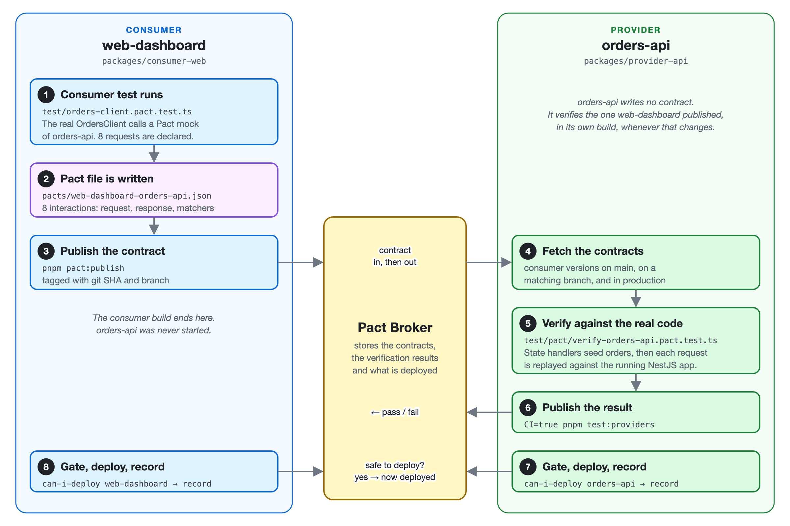
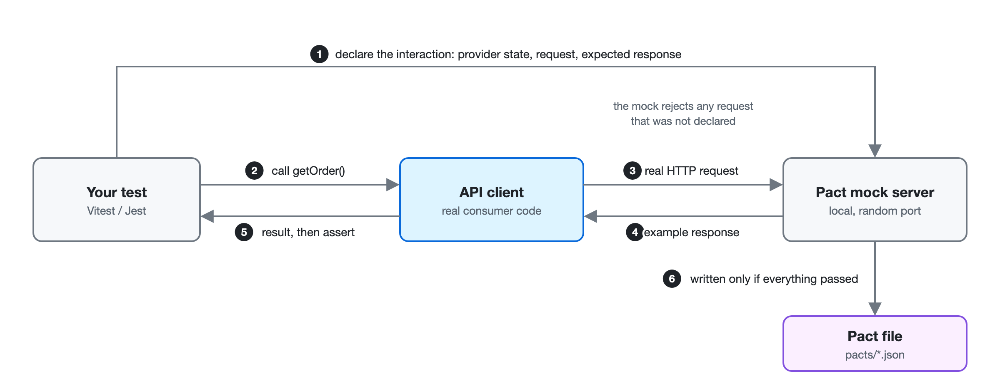
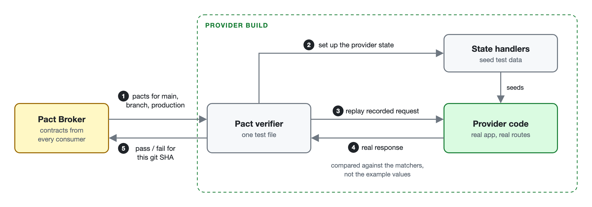
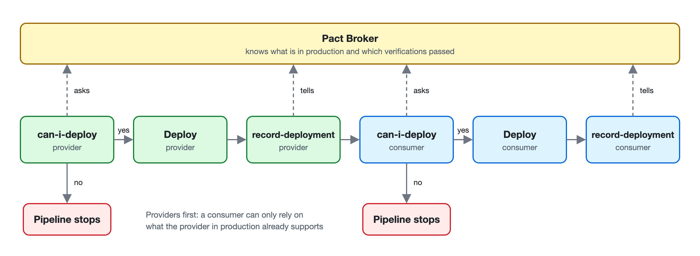
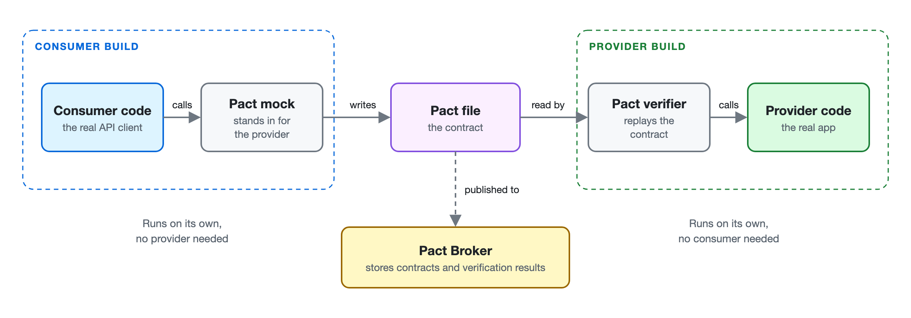
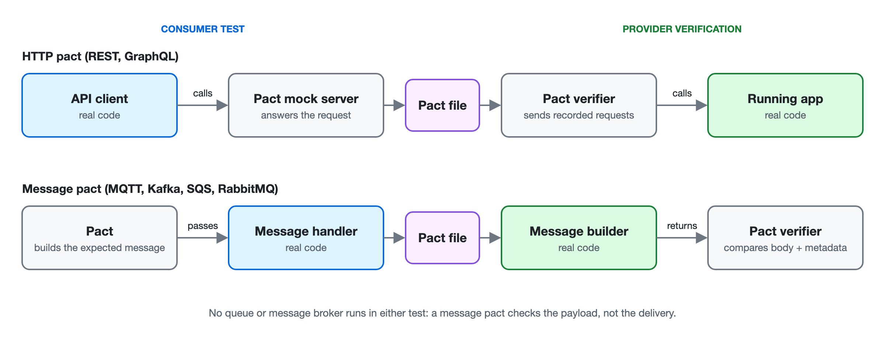
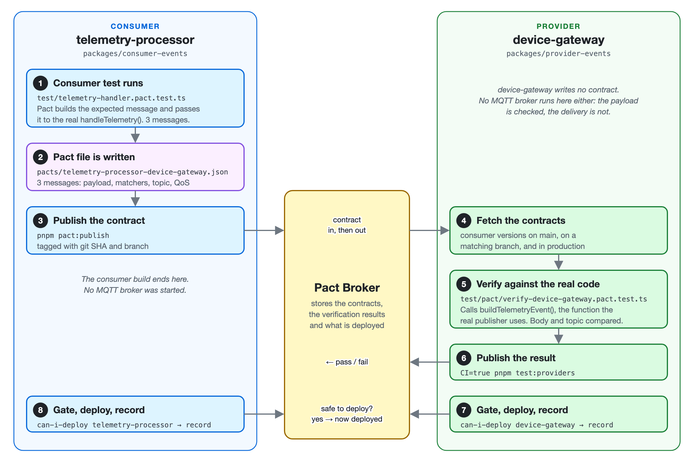

# Contract Testing with Pact — What It Is and How to Add It to Your Repos

*Consumer tests, provider verification and a deploy gate, for HTTP APIs and MQTT messages — with a repo you can copy from.*

A backend developer renames `totalPence` to `total`. Their unit tests pass. Their API tests pass. The pull request is merged and deployed.

The dashboard that reads `totalPence` now shows a blank where the price should be. Nobody on the backend team knew the dashboard used that field, and nothing in their pipeline could have told them.

The usual answer is an end-to-end test: deploy both services, click through, see what breaks. It works, but it's slow, it's flaky, and it tells you after the merge.

Contract testing answers the same question in the pull request, without running the two services together. This post is how it works and what you need to add it to your own repos. The examples are condensed from a small repo I built for this: [contract-testing-lab](https://github.com/richardforjoejnr/contract-testing-lab).

## The whole flow in one picture

Two services talk. The one that asks is the **consumer**. The one that answers is the **provider**. The **contract** is a file that records what the consumer needs.

Here is everything this post covers, using the two HTTP services from the repo. Follow the numbers. You don't need every box yet; the rest of the post walks through them one at a time.



- The consumer is tested against a fake provider. That test writes the contract.
- The provider is tested by replaying the contract against the real provider code.

If both pass against the same file, they can talk to each other. I use [Pact](https://docs.pact.io), where the consumer writes the contract, because the consumer is the one who knows which fields it really reads.

## It isn't only for REST

This was the part I didn't know before I started. Pact works for any interface where one side sends structured data and the other reads it:

- **HTTP / REST** — built in.
- **GraphQL** — it travels over HTTP, so it's an HTTP pact.
- **MQTT, Kafka, RabbitMQ, SQS / SNS** — as a *message pact*. Pact doesn't care which transport carries the message.
- **gRPC / Protobuf** — through a plugin.

Rule of thumb: **you ask and get an answer → HTTP pact. Someone publishes and someone else reads later → message pact.**

Where it fits badly: public APIs with consumers you don't know, and third-party APIs whose owners will never run your contract.

## What you need

Two packages and a test runner you already have:

```bash
npm install --save-dev @pact-foundation/pact       # every consumer and provider
npm install --save-dev @pact-foundation/pact-cli   # gives you the pact-broker command
```

Plus a **Pact Broker**, a server that stores contracts and results. More on that below; you don't need one for the first two steps.

## Step 1: the consumer test writes the contract

Keep every call to the provider in one module, and let the base URL be passed in. Then write a test that describes one request and the response you need:

```ts
const pact = new PactV4({ consumer: 'web-dashboard', provider: 'orders-api', dir: 'pacts' });

it('returns the order detail the dashboard renders', async () => {
  await pact
    .addInteraction()
    .given('an order ord-8f3a91 exists for customer cus-1042')
    .uponReceiving('a request for order ord-8f3a91')
    .withRequest('GET', '/orders/ord-8f3a91')
    .willRespondWith(200, (builder) => {
      builder.jsonBody({
        id: regex(/^ord-[0-9a-f]{6}$/, 'ord-8f3a91'),
        status: regex(/^(PLACED|PICKING|READY|COLLECTED|CANCELLED)$/, 'PICKING'),
        totalPence: integer(5100),
        customer: { displayName: like('P. Nandakumar') },
        lines: eachLike({ sku: like('SKU-77120'), quantity: integer(2) }, 1),
      });
    })
    .executeTest(async (mockServer) => {
      const client = new OrdersClient({ baseUrl: mockServer.url });
      const order = await client.getOrder('ord-8f3a91');

      expect(order.totalPence).toBe(5100);
    });
});
```



Pact starts a mock server, your real client calls it, and the mock checks the request is the one you declared. Only when the test passes does Pact write the interaction to `pacts/web-dashboard-orders-api.json`. The contract can't claim something your code doesn't do.

**The matchers are the important part.** `integer(5100)` means "any whole number", not "5100". `like(...)` means "same type". `regex(...)` means "this format". If you pin exact values, the provider's build goes red every time someone edits test data, and people stop reading it. Use an exact value only when the exact value is the requirement.

And only put in what the consumer actually reads. Everything else is a field the provider can no longer change for no reason.

## One contract file per pair, not per test

I wasn't sure about this at first, so to be explicit: you don't get a file per test. You get **one pact file per consumer–provider pair**, and each test that passes adds its interaction to it. In the repo, eight tests produce one `web-dashboard-orders-api.json` with eight interactions. The MQTT consumer produces a second file, because that's a different pair.

**Runs are merged into the file, not replaced.** Run one test into an empty folder and the file has 1 interaction; run a different test and it has 2. So if you delete or rename a test, the old interaction stays in your local file until you delete the `pacts/` folder. CI starts from a clean checkout, so only your laptop is affected.

**That shared file is also the limit on running in parallel.** Test files for the same pair must not write it from separate processes at once: five copies of the consumer test across five worker processes failed 3 runs in 5 with `The pact core was unable to write the pact file`. Different pairs write different files, so they run side by side without trouble. Provider verification only reads pacts, so it does too: every package in the repo passes with `PACT_PARALLEL=1 pnpm test`, and the provider suites finish in about half the time. The rule: one pact test file per pair, or run that pair's files one at a time (`fileParallelism: false` in Vitest, `--runInBand` in Jest).

## Is that a unit test?

On the consumer side, yes. It's a unit test of your API client that uses Pact's mock instead of one you wrote by hand. The contract is a side effect of it passing. There's no separate "generate the contract" step.

It doesn't replace your other unit tests, because it checks a different thing:

- **Contract test:** `totalPence` is an integer.
- **Unit test:** `totalPence` is quantity × unit price.

A provider that returned 42 for every order would pass the contract.

**If you already have unit tests:** find the ones that mock the network — `nock`, `msw`, a stubbed `fetch`. Those mocks are your current, unchecked guesses about the provider. Swap each one for a Pact interaction and keep the assertions. Leave every other test alone.

## Step 2: publish it

```bash
pact-broker publish pacts/ \
  --consumer-app-version "$(git rev-parse --short=12 HEAD)" \
  --branch "$(git rev-parse --abbrev-ref HEAD)" \
  --broker-base-url "$PACT_BROKER_BASE_URL" \
  --broker-token "$PACT_BROKER_TOKEN"
```

Use the git SHA as the version, never the `package.json` version. A version has to mean exactly one build.

## Step 3: the provider verifies it

The provider doesn't write a contract. It downloads the consumers' contracts and proves it satisfies them. The whole test:

```ts
it('verifies every interaction in the contract', async () => {
  await new Verifier({
    provider: 'orders-api',
    providerBaseUrl: `http://127.0.0.1:${port}`,     // the real app, started in beforeAll
    stateHandlers: {
      'an order ord-8f3a91 exists for customer cus-1042': async () => {
        repository.reset();
        repository.seedOrder(ORDER_8F3A91);
      },
    },
    pactBrokerUrl: process.env.PACT_BROKER_BASE_URL,
    pactBrokerToken: process.env.PACT_BROKER_TOKEN,
    consumerVersionSelectors: [
      { mainBranch: true },
      { matchingBranch: true },
      { deployedOrReleased: true },
    ],
    enablePending: true,
    providerVersion: gitSha,
    providerVersionBranch: gitBranch,
    publishVerificationResult: process.env.CI === 'true',
  }).verifyProvider();
});
```



There are no expected values in that file. The consumer's contract is the test.

Three things in it earn their place:

**State handlers seed data, they don't fake responses.** The consumer said "given an order exists". The handler makes that true, and the real controller has to produce the response.

**The selectors decide which consumers you must not break.** What `main` expects, a consumer branch with the same name as yours, and — the one people forget — whatever is in production right now.

**`enablePending` keeps consumers from breaking your build.** A brand-new expectation you've never passed is reported, not failed. The consumer is blocked from deploying instead, which is the right way round.

When the developer from the top of this post renames that field, this is where it stops: in their own pull request, with the consumer, the interaction and the field named. A failure looks like this:

```
1) Verifying a pact between web-dashboard and orders-api
   Given an order ord-8f3a91 exists for customer cus-1042 - a request for order ord-8f3a91
    1.1) has a matching body
           $.totalPence -> Expected 1278 (Integer) to be equal to 4750 (Integer)
```

That output is from the repo's `pnpm demo:brittle`, where a contract pinned to exact values meets the real provider. It's also a preview of what over-pinning does to you.

## Step 4: the deploy gate

Green tests on your branch say nothing about the consumer version that's been in production for three weeks. The broker knows about that version. So before every deploy, ask it:

```bash
pact-broker can-i-deploy --pacticipant orders-api \
  --version "$GIT_SHA" --to-environment production
```

And after the deploy succeeds, tell it:

```bash
pact-broker record-deployment --pacticipant orders-api \
  --version "$GIT_SHA" --environment production
```



**Skip `record-deployment` and the gate quietly stops working.** It can only compare against what it's been told is in production.

**Providers go first.** A consumer that needs something new can't ship until the provider that supports it is live.

## Why this works: two builds that never meet

Strip away the commands and that is the whole trick. Each side is tested on its own, against the same file, and the broker carries that file and the results between them.



## Messages: MQTT, Kafka and friends

With a queue there's no request to intercept, so the test turns around.



On the consumer side, Pact builds the message you say you expect and hands it to your real handler:

```ts
await pact
  .addAsynchronousInteraction()
  .given('a device reporting normal telemetry')
  .expectsToReceive('device telemetry v1, no active faults', (builder) => {
    builder.withMetadata({ topic: 'retailops/v1/stores/store-0042/devices/dev-000123/telemetry' });
    builder.withJSONContent({
      deviceId: regex(/^dev-\d{6}$/, 'dev-000123'),
      batteryPct: integer(87),
      uptimeSeconds: integer(45_123),
      faults: [],
    });
  })
  .executeTest(async (message) => {
    const snapshot = handleTelemetry(message.contents.content);
    expect(snapshot.batteryState).toBe('ok');
  });
```

On the provider side, the verifier calls the function that builds the message:

```ts
messageProviders: {
  'device telemetry v1, no active faults': providerWithMetadata(
    () => buildTelemetryEvent(NORMAL_READING),
    TRANSPORT_METADATA,
  ),
},
```

Two things make this work. The handler has to be a plain function, separate from the MQTT client. And `buildTelemetryEvent` has to be the same function the real publisher calls. Verify a hand-written sample instead and you've proved the sample is correct, nothing more.

Here is the diagram from the top of the post again, this time for the MQTT pair. The steps and commands are identical; only what happens inside steps 1 and 5 changes.



## The commands, as package.json scripts

None of this has to be remembered. In the repo every step is a script, so CI and a laptop run exactly the same thing:

```json
{
  "scripts": {
    "test": "pnpm test:consumers && pnpm test:providers",
    "test:consumers": "pnpm --filter \"./packages/consumer-*\" test",
    "test:providers": "pnpm --filter \"./packages/provider-*\" test",
    "broker:up": "docker compose up -d postgres broker && ./scripts/wait-for-broker.sh",
    "pact:publish": "./scripts/publish-pacts.sh",
    "pact:can-i-deploy": "./scripts/can-i-deploy.sh",
    "pact:record-deployment": "./scripts/record-deployment.sh",
    "loop": "./scripts/full-loop.sh"
  }
}
```

Each consumer and provider package only needs `"test": "vitest run"`. The three shell scripts are thin wrappers around the `pact-broker` commands above, so the version and the branch are worked out in one place.

The whole loop on your machine, one step at a time:

```bash
pnpm broker:up                                      # local broker on localhost:9292
export PACT_BROKER_BASE_URL=http://localhost:9292
pnpm test:consumers                                 # 1. write the pact files
pnpm pact:publish                                   # 2. publish them
CI=true pnpm test:providers                         # 3. verify, publish the results
pnpm pact:can-i-deploy orders-api production        # 4. gate the provider
pnpm pact:record-deployment orders-api production   # 5. record it
pnpm pact:can-i-deploy web-dashboard production     # 6. gate the consumer
pnpm pact:record-deployment web-dashboard production
```

Or `pnpm loop` for all of it. Run it twice: the first time production is empty, so there is nothing to compare against. The second time the gate is checking against real recorded deployments.

## Setting up the broker

[pact.io](https://docs.pact.io) is the documentation. The broker is something you run or rent:

- **Locally:** the open-source broker is a Docker image plus Postgres. In the repo, `pnpm broker:up` starts one on `localhost:9292`.
- **Hosted:** [PactFlow](https://pactflow.io). Create an account, copy a read/write API token from the settings, and set two values in CI: `PACT_BROKER_BASE_URL` and `PACT_BROKER_TOKEN`.

You don't create anything by hand. Participants appear the first time a pact is published. The only setup is making sure a `production` environment exists.

## What it doesn't do

It doesn't check values are right. An integer is an integer.

It doesn't check units. If a publisher switches `uptimeSeconds` to milliseconds, it's still an integer and still passes. The fix in the repo is boring: put the unit in the field name, so a unit change becomes a rename, which the contract does catch.

It doesn't check message delivery. Subscriptions, ordering and redelivery are outside the contract.

You still need unit tests for logic and a few end-to-end checks. What you can drop is the big slow suite whose real job was finding out whether two services still agreed on field names.

## Where to start

- Pick one consumer and one provider that already talk.
- Write two or three consumer interactions and get a pact file out.
- Verify it on the provider from the local file. No broker yet.
- Add a broker and publish from CI on both sides.
- Add `can-i-deploy` as a report first, then make it block.
- Add `record-deployment`.

The repo runs the whole loop with `pnpm install && pnpm test`, no broker needed, and has a longer guide with every command: [github.com/richardforjoejnr/contract-testing-lab](https://github.com/richardforjoejnr/contract-testing-lab).
